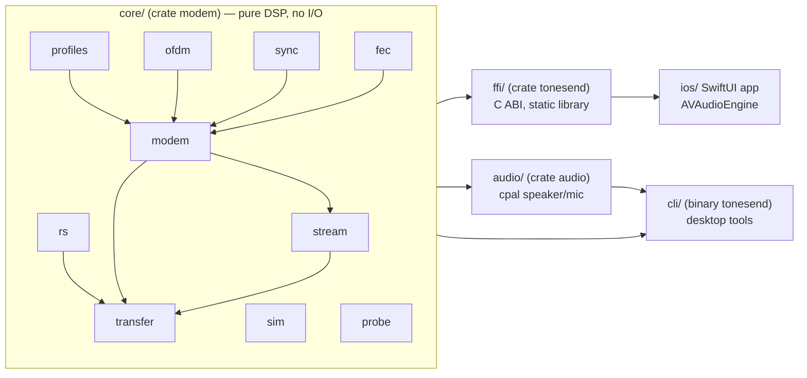
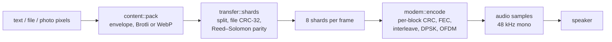
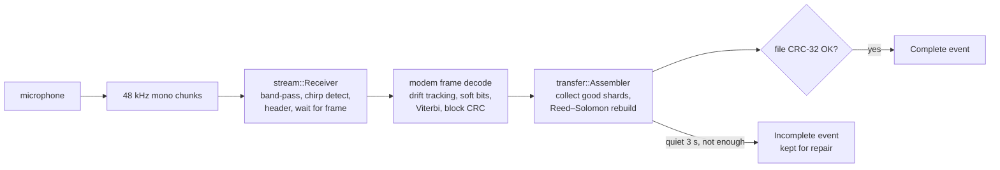

# Architecture

## Components



| Path | Crate / target | Responsibility |
|---|---|---|
| `core/` | `modem` (lib) | All signal processing and protocol logic. No audio I/O, no threads, fully testable offline |
| `audio/` | `audio` (lib) | Desktop playback/capture via cpal (CoreAudio, WASAPI, ALSA, AAudio, WebAudio); mono 48 kHz in/out |
| `cli/` | `tonesend` (bin) | Encode/decode WAV, live listen, channel simulation, benchmarks, channel measurement |
| `ffi/` | `tonesend` (staticlib) | Stable C interface (`ffi/include/tonesend.h`) for mobile apps |
| `ios/` | ToneSend app | SwiftUI UI, AVAudioEngine audio, links `libtonesend.a` |
| `scripts/` | | `build-ios.sh`: builds the static library for device/simulator (run by Xcode) |

The design rule: **everything that decides bits lives in `core/`**. Apps only move audio
samples and draw UI, so Android/Flutter/web front ends reuse the same modem unchanged.

## Core modules

| Module | Role |
|---|---|
| `profiles.rs` | Band profiles (frequencies, FFT size, cyclic prefix, …) and rate profiles (modulation + code rate) |
| `ofdm.rs` | One OFDM symbol: subcarrier values ↔ time samples; clip-and-filter peak limiting |
| `sync.rs` | Chirp preamble, normalised analytic matched filter, peak picking, band-pass filter |
| `fec.rs` | K=7 convolutional code, puncturing (½, ⅔, ¾), soft-decision Viterbi |
| `modem.rs` | Frame encoder/decoder: preamble, header, blocks, differential (D)PSK, drift tracking, soft bits |
| `stream.rs` | `Receiver`: real-time decoding from arbitrary sample chunks, live status |
| `rs.rs` | Reed–Solomon erasure code over GF(256) (Cauchy, systematic) |
| `transfer.rs` | Transfer layer: shards, groups, repair data, `Assembler`, `TransferReceiver` |
| `content.rs` | Content envelope; Brotli compression with a shared dictionary; image downscale + WebP encode/decode |
| `sim.rs` | Acoustic channel simulator (speaker/mic response, reverb, clock drift, clipping, noise), resampler |
| `probe.rs` | Channel-measurement probe signal and its analysis |
| `util.rs` | Deterministic RNG, CRC-16/32, bit packing, interleaver permutations |

## Data flow

### Sending



### Receiving



The receiver works incrementally: `push()` accepts any chunk size; preamble scans run every
~0.2 s of new audio; once a header is decoded the receiver knows how many samples the frame
needs and decodes it as soon as they have arrived. Memory is bounded: without a frame in
progress at most ~3 s of audio is kept.

## iOS app

```mermaid
flowchart TB
  UI[SwiftUI views<br/>Send / Receive / Lab / Detail] <--> M[AppModel<br/>@MainActor]
  M --> A[AudioIO<br/>AVAudioEngine]
  A -- mic tap, converted to 48 kHz mono --> P[RxPipeline<br/>serial DSP queue]
  P --> R[ModemReceiver<br/>Swift wrapper]
  R --> F[libtonesend.a<br/>Rust]
  M -- encode / repair --> W[Modem enum<br/>Swift wrapper] --> F
  P -- events, status at ~12 Hz --> M
```

| File | Role |
|---|---|
| `ToneSendApp.swift` | App entry, tab view, error alert |
| `AppModel.swift` | State: listening, received/sent lists, sending progress; send/repair/probe/raw-recording actions; `RxPipeline` (serial queue owning the decoder) |
| `AudioIO.swift` | Audio session (`.playAndRecord`, **`.measurement` mode** so iOS applies no AGC/noise suppression), engine, mic tap + sample-rate conversion, playback; WAV writer |
| `Modem.swift` | Swift wrappers over the C API: profiles, encode/repair, `ModemReceiver`, stats types |
| `Transfer.swift` | App-level envelope (text vs named file), `Transfer` model, formatting |
| `Views/*` | Send, Receive, TransferDetail (stats + SNR chart), Lab, shared components |

Threading rules:
- The audio thread only converts samples and hands them to `RxPipeline`.
- All decoding happens on one serial queue (the Rust receiver is not thread-safe).
- UI state changes happen on the main actor.
- While the phone itself is playing (sending, probe), decoding is paused so it does not
  decode its own sound. **Partially received transfers are kept** across pauses and
  listening sessions, so repair data sent later still merges.

## C interface (ffi)

Defined in `ffi/include/tonesend.h`, exposed to Swift as module `ToneSendKit`
(`ffi/include/module.modulemap`).

| Function | Purpose |
|---|---|
| `ts_transfer_encode(data, len, band, rate, id, redundancy, &n)` | Audio for a transfer |
| `ts_transfer_repair(data, len, band, rate, id, sent, extra, &n)` | Audio with new repair data |
| `ts_transfer_seconds(len, band, rate, redundancy)` | Air-time estimate |
| `ts_net_bitrate(band, rate, len)` | Link rate of a profile |
| `ts_receiver_new(band_mask)` / `ts_receiver_free` | Streaming receiver |
| `ts_receiver_push(rx, samples, n)` | Feed mic samples; returns number of queued events |
| `ts_receiver_next_event(rx)` / `ts_event_free` | Completed / incomplete transfers with stats and data |
| `ts_receiver_status(rx)` | Activity, level, current packet progress, blocks have/needed/lost |
| `ts_pack_text`, `ts_pack_file`, `ts_pack_image` | Envelope + compression → bytes to send; `TsPackInfo` reports original/packed size |
| `ts_image_encode_rgba`, `ts_image_decode` | Photo pixels → downscaled WebP; WebP → RGBA |
| `ts_unpack` / `ts_content_free` | Received bytes → kind, name, decompressed data |
| `ts_encode`, `ts_probe_generate`, `ts_samples_free`, `ts_bytes_free` | Single raw frame, probe signal, free buffers |

Ownership: buffers returned by the library are freed with the matching `*_free` function.
Band ids: 0 Audible (wide), 1 Robust (narrow), 2 Silent (inaudible), 3 Max, 4 High
(experimental, desktop only so far). Rate ids: 0 Safe,
1 Normal, 2 Fast, 3 Turbo. These ids are part of the wire format; only append new ones.

## Extending

- **New band profile:** add a variant to `Band` (append to `Band::ALL`), its `OfdmParams`, a
  name/parse entry; mirror the case in `ios/App/Modem.swift` (`BandProfile`, same raw value).
- **New rate:** add to `Rate` (id, bits per carrier, code rate); mirror in `RateProfile`;
  calibrate `probe::required_snr_db` with `tonesend bench`.
- **Android:** build `tonesend` for `aarch64-linux-android`, call the same C API via JNI
  (or `flutter_rust_bridge` for Flutter); use `AudioSource.UNPROCESSED` for the microphone.
